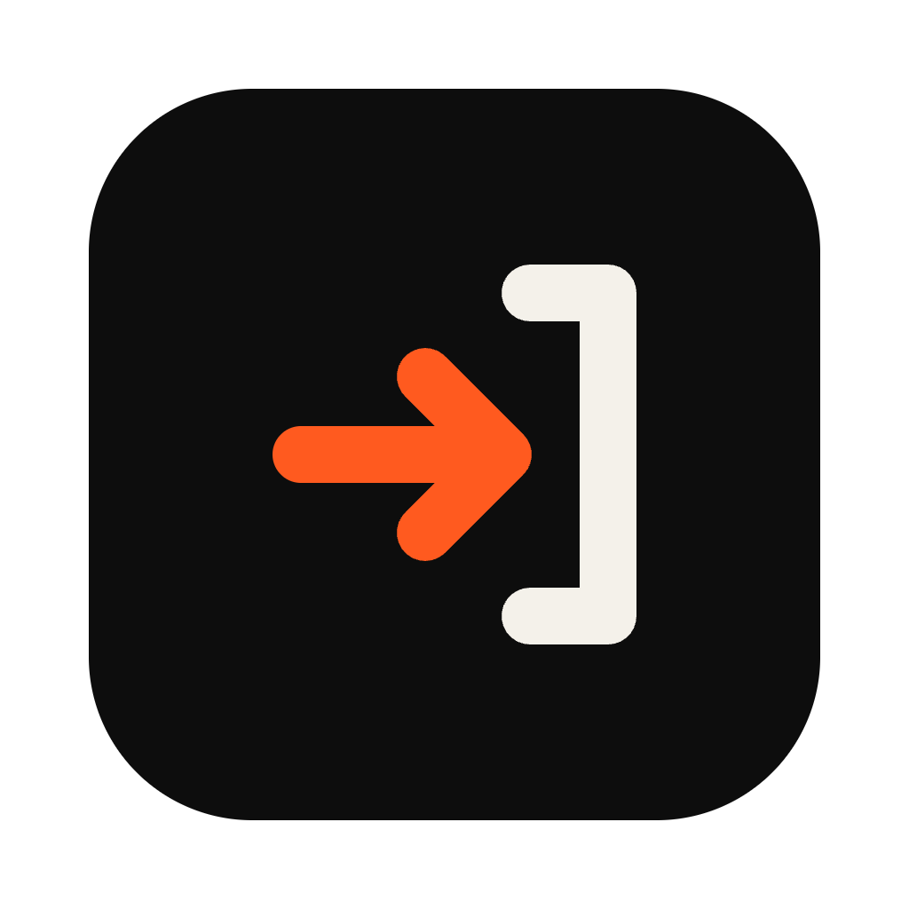
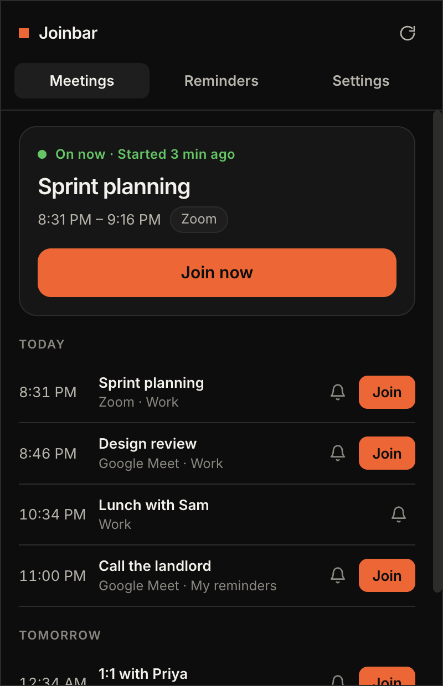
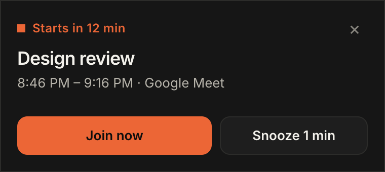

<p align="center">
  
</p>

<h1 align="center">Joinbar</h1>

<p align="center">
  Your next meeting in the Windows tray, with a reminder that has a <b>Join</b> button.<br>
  Free, private, no account.
</p>

<p align="center">
  
  &nbsp;
  
</p>

---

Joinbar sits in the system tray and does one job: get you into your meetings fast.

- **Tray icon with a countdown:** the minutes until your next meeting are drawn inside the icon. It turns orange in the last 5 minutes and shows a green **!** while a meeting is on.
- **One-click join:** Zoom, Google Meet, Microsoft Teams, Webex, Whereby, Jitsi, GoToMeeting, Slack huddles and Discord links are found in the event for you.
- **Reminders your way:** choose when they pop up (10 min and 1 min before, or anything you like), change them for a single meeting, or mute one. The pop-up has **Join now**, **Snooze** and **Dismiss**.
- **Your own reminders:** add a reminder that isn't in any calendar (once, every day, every weekday or every week), with an optional meeting link, so it also gets a Join button.
- **A join shortcut:** a keyboard shortcut (default **Ctrl + Alt + J**) joins the meeting that's on now, or the next one, from any app.
- **Private:** your calendar link and reminders stay on your PC. There's no account and no server. The only network requests are to download your calendar from the link you give it.

<p align="center"></p>

## What has been tested

| | |
|---|---|
| Calendar reading: repeating events, moved and cancelled ones, time zones, join links | 24 automated tests |
| The running app: joining, the shortcut, reminders, link safety, fetching a calendar from a web address (including a dead link and no network) | 34 checks that drive the real app |
| The Windows `.exe` | **Built, but not yet run on a Windows PC.** The first real run is yours. Please try the checklist below |

## Install

Download from the [latest release](../../releases/latest):

- **`Joinbar-Setup-1.0.0.exe`**: installs for your account (no admin needed) and can start with Windows.
- **`Joinbar-1.0.0-portable.exe`**: runs without installing. "Start with Windows" only works with the installer.

The app isn't code-signed, so Windows SmartScreen shows "Windows protected your PC". Choose **More info**, then **Run anyway**. Windows 11 may hide new tray icons in the **^** overflow: drag the Joinbar icon onto the taskbar to keep it visible.

## Set it up

1. Click the tray icon, open **Settings** and paste your calendar link.
   - **Google Calendar:** Settings, your calendar, **Secret address in iCal format**.
   - **Outlook / Microsoft 365:** Settings, Calendar, Shared calendars, **Publish a calendar**, copy the **ICS** link.
2. Your meetings appear. Click **Join**, or press **Ctrl + Alt + J**.
3. Open **Reminders** to choose when pop-ups appear, or to add your own.

Treat the calendar link like a password: anyone with it can read your calendar. You can reset it in Google or Outlook at any time.

## Please check on Windows

- [ ] The tray icon appears and shows a number for your next meeting
- [ ] Clicking it opens the popup above the taskbar, and clicking away closes it
- [ ] A reminder pop-up appears at the bottom right with the sound (Settings, Test reminder)
- [ ] **Join** opens the meeting in your browser or the Zoom/Teams app
- [ ] The shortcut works while another app is in front
- [ ] After a restart with the installer, "Start with Windows" brings it back

## Build from source

```sh
npm install
node node_modules/electron/install.js   # downloads the Electron app shell if npm skipped it
npm start                                # run it (npm start -- --demo uses sample meetings)
npm test                                 # unit tests
npx electron . --selftest                # drives the real app (links are recorded, not opened)
npm run dist:win                         # builds installers into dist/ (works from macOS too)
```

`npx electron . --screenshots <folder>` writes the pictures used in this README.

## Known limits

- Reads calendars from a link (ICS), not by signing in to Google or Microsoft. Google's link can take a few minutes to show changes.
- Declined invitations aren't hidden yet, and all-day events are ignored.
- Calendar events show up to 7 days ahead.

## Built with

[Electron](https://www.electronjs.org/) and [ical.js](https://github.com/kewisch/ical.js) (MPL-2.0) for reading calendars, and the [Inter](https://rsms.me/inter/) font (SIL OFL). Joinbar's own code is MIT licensed; see [LICENSE](LICENSE).
